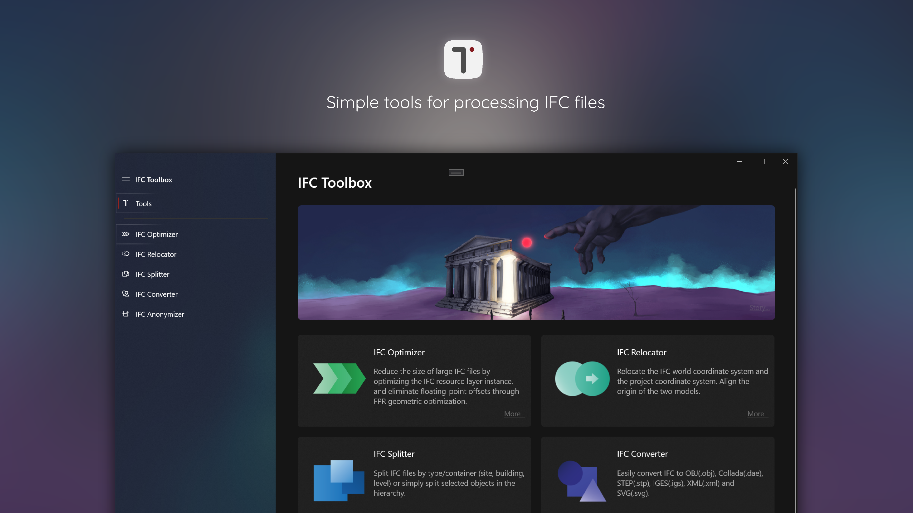
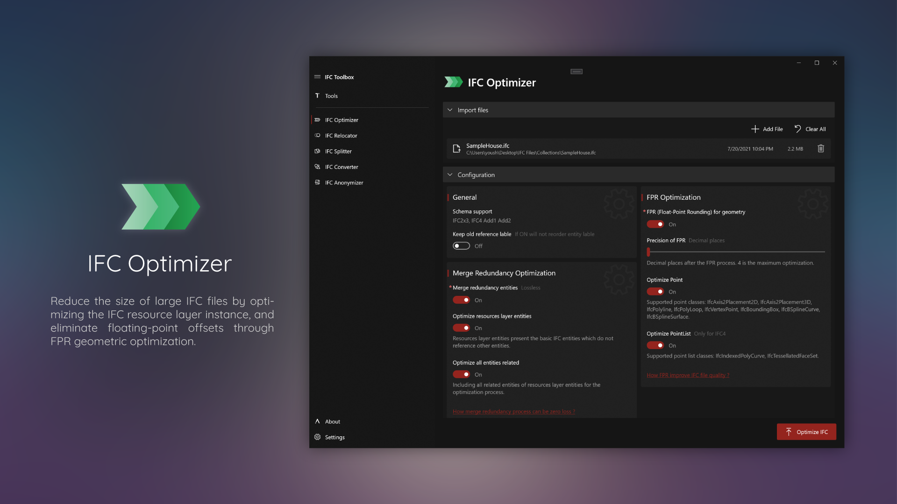
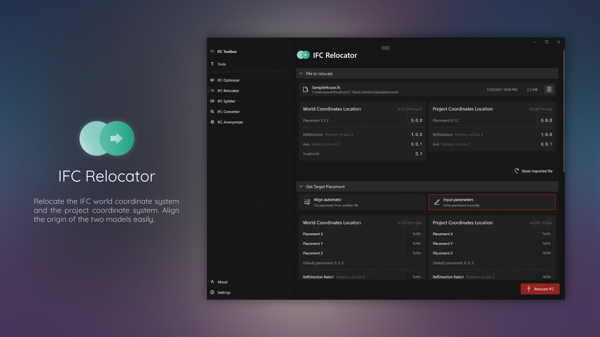
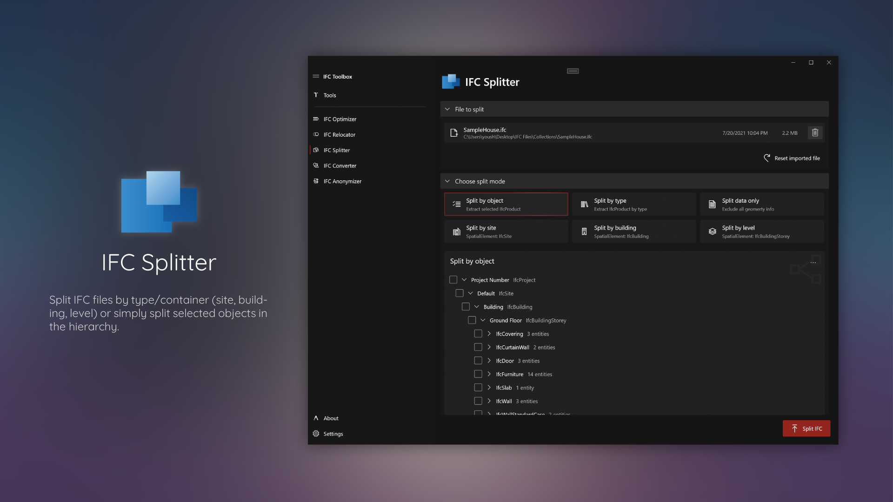
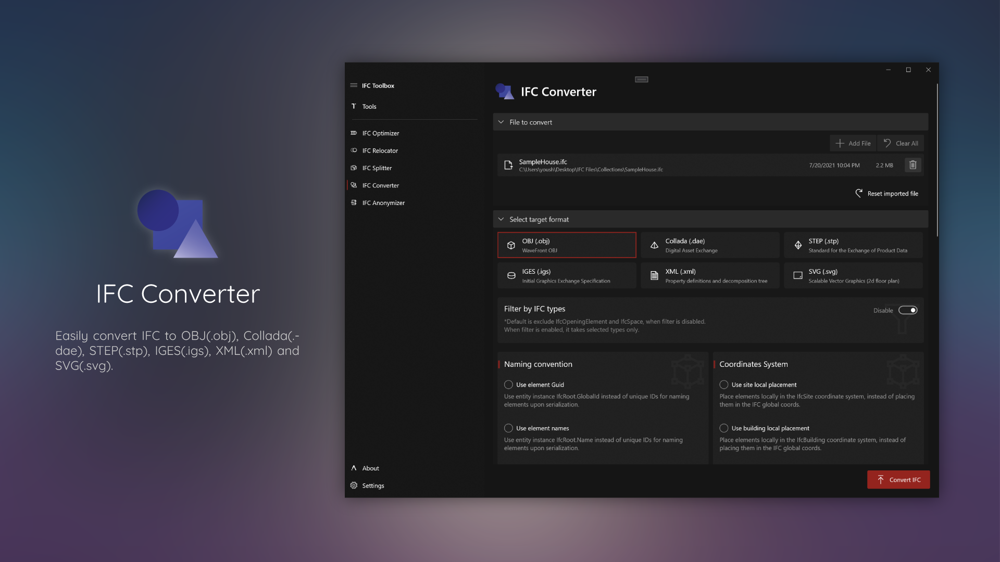
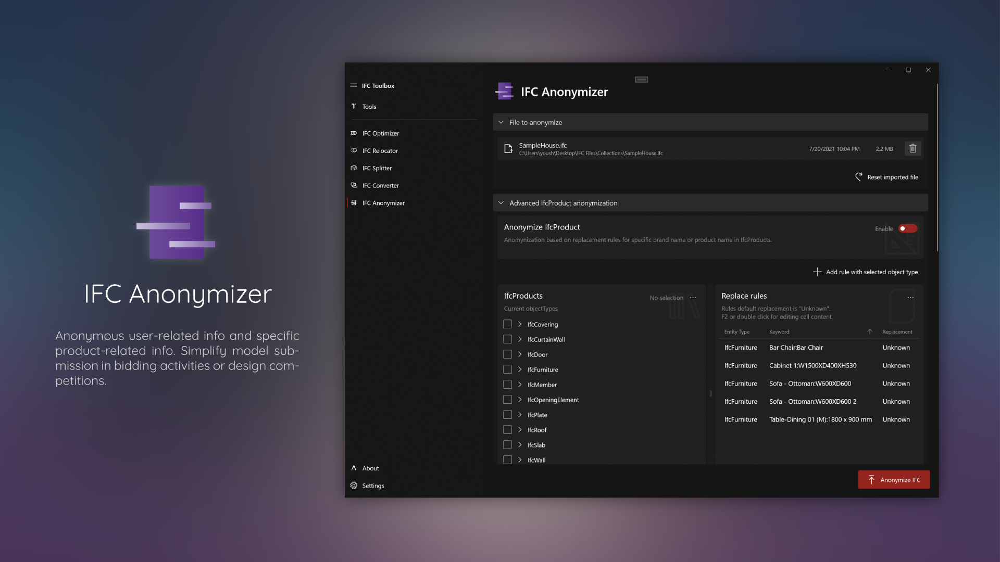

<p align="center">
  
</p>
<h1 align="center">
  IFC Toolbox
</h1>
<p align="center">
  Simple tools for processing IFC files.
</p>
<p align="center">
  <a style="text-decoration:none" href="https://www.microsoft.com/en-us/p/ifc-toolbox/9n77phd2h471#activetab=pivot:overviewtab">
    
  </a>
  <a style="text-decoration:none" href="https://github.com/youshengCode/IfcToolbox/releases">
    
  </a>
  <a style="text-decoration:none" href="https://bimmars.com">
    
  </a>
</p>

> **About this repository.** This is a modified continuation of [IfcToolbox](https://github.com/youshengCode/IfcToolbox) by Yousheng Wang, which is no longer maintained upstream. It was imported from upstream version 1.2.1 and modified from September 2026 onwards: moved to .NET 8 and xbim 6, added IDS 1.0 validation, IFC 4.3 support, glTF output, a rewritten bSDD client and the `ifctoolbox` command line tool. The git history records every change. The Microsoft Store app, its releases and the badges above belong to the original project. This repository rebuilds the desktop app from scratch in WinUI 3 (`IfcToolbox.App`, see [Desktop app](#desktop-app)) and does not publish to the Store.


IfcToolbox is a .Net kit of simple tools for processing IFC files. It provides tools to optimize, convert, split, relocate, anonymize and validate IFC files easily. Based on open-source libraries like [Xbim](https://docs.xbim.net/) and [IfcOpenShell](http://ifcopenshell.org/). 

IfcToolbox is one of the proposals in [openBIM Marketplace - buildingSMART Technical](https://technical.buildingsmart.org/misc/openbim-marketplace/). Thank you all for ❤️ IFC Toolbox and bring IFC Toolbox to buildingSMART International Summit 2021.

> IfcToolbox is a FREE software for support OpenBIM.

## Tools in the box

- IFC Optimizer – Reduce the size of large IFC files by optimizing the IFC resource layer instance, and eliminate floating-point offsets through FPR geometric optimization.
- IFC Converter – Easily convert IFC to glTF(.glb), OBJ(.obj), Collada(.dae), STEP(.stp), IGES(.igs), XML(.xml), SVG(.svg) and IFC-SPF(.ifc). Point `IFCTOOLBOX_IFCCONVERT` at an IfcConvert 0.8 build to also get xeokit JSON(.json), RDF Turtle(.ttl) and HDF(.h5).
- IFC Splitter – Split IFC files by type/container (site, building, level) or simply split selected objects in the hierarchy. For IFC 4.3 infrastructure models, also by facility (road, railway, bridge, marine facility) and facility part (carriageway, track, ...).
- IFC Combiner – Combine models of the same schema and length unit into one file with a single project. Sites, buildings and storeys that are the same (same GlobalId, or same name) and placed alike are merged; an element found in several files is copied once; duplicate GlobalIds are renewed. Not in the original app.
- IFC Relocator – Relocate the IFC world coordinate system and the project coordinate system. Align the origin of the two models. Georeference IFC4 and IFC 4.3 models with a projected CRS and map conversion (IfcMapConversion, and IfcMapConversionScaled on IFC 4.3).
- IFC Anonymizer – Anonymous user-related information and specific product-related information. Simplify model submission in bidding activities or design competitions.
- IFC Validator – Validate the existence of the properties of classes in the IFC file. Requirements can be pulled directly from the buildingSMART Data Dictionary (bSDD) instead of being written out by hand; they are turned into IDS, checked by the IDS engine and can be saved as an `.ids` file to share.
- IDS Validator – Check a model against an [Information Delivery Specification](https://www.buildingsmart.org/standards/bsi-standards/information-delivery-specification-ids/) (IDS 1.0, the official buildingSMART standard since June 2024). Reads and writes `.ids` files and checks entity, attribute, property, classification, material and partOf facets, with restrictions, cardinality and unit conversion. Verified against all 307 runnable cases of the official buildingSMART test suite.

## Command line

```
dotnet tool install -g IfcToolbox.Cli --prerelease

ifctoolbox info model.ifc
ifctoolbox validate model.ifc --ids requirements.ids --report findings.csv
ifctoolbox convert model.ifc --format glb
ifctoolbox split road.ifc --by facility --list
ifctoolbox split road.ifc --by part --item "#146"
ifctoolbox combine architecture.ifc structure.ifc mep.ifc -o building.ifc
ifctoolbox optimize model.ifc --precision 4 --output small.ifc
ifctoolbox anonymize model.ifc
ifctoolbox georef model.ifc --crs EPSG:25832 --eastings 333000 --northings 5800000
```

Or build a standalone `ifctoolbox.exe` that needs no .NET installation, with IfcConvert beside it (every CI run also uploads one as the `ifctoolbox-win-x64` artifact):

```
dotnet publish IfcToolbox.Cli -c Release -r win-x64 --self-contained true -p:PublishSingleFile=true -p:EnableCompressionInSingleFile=true -p:IncludeNativeLibrariesForSelfExtract=true -p:DebugType=none -o publish/ifctoolbox-win-x64
```

Exit codes: `0` success, `1` the model failed validation, `2` usage error, `3` error. `validate` exiting with `1` lets it gate a CI pipeline; add `--json` to `info`, `validate` or `georef` for machine readable output.

### Supported IFC versions

IFC2X3, IFC4 and IFC 4.3 (IFC4X3_ADD2, ISO 16739-1:2024) for every tool. Converting IFC 4.3 models needs IfcConvert 0.8 or newer: the bundled IfcConvert 0.6 predates IFC 4.3, so point the `IFCTOOLBOX_IFCCONVERT` environment variable at a newer build.

## Desktop app

A new desktop app with every tool, rebuilt in WinUI 3 because the original app's source was never published. It follows the original's layout and adds the IFC Combiner, IDS validation, requirements from bSDD that can be saved as IDS, IFC 4.3 splitting by facility and facility part, glTF output and georeferencing.

It needs no installation: unzip it and run `IfcToolbox.exe` (Windows 10 1809 or later, x64). Every CI run uploads it as the `IfcToolbox-app-win-x64` artifact, and tagged releases attach it as a zip. To build it yourself, see [Source code projects](#source-code-projects).

Settings are kept in `%LOCALAPPDATA%\IfcToolbox\settings.json`; if the app crashes it describes why in `crash.log` beside them. Converting IFC 4.3 models needs a newer IfcConvert, which can be chosen under Settings.

## The original app in the Microsoft Store

The original IFC Toolbox app by Yousheng Wang, version 1.2.1, which this repository does not maintain. It was **designed for No-Code users and to provide a better user experience.**

**[Download IFC Toolbox from Microsoft Store](https://www.microsoft.com/en-us/p/ifc-toolbox/9n77phd2h471#activetab=pivot:overviewtab)**

*If you cannot install directly from Microsoft Store, you can use the [released sideload package](https://github.com/youshengCode/IfcToolbox/releases) to install IFC Toolbox in your PC. [The detailed process can be found here](https://youshengcode.github.io/IfcToolbox.Doc/#/Main/Download).

### Videos

IFC Toolbox in [buildingSMART International](https://www.buildingsmart.org/) Summit 2021, OpenBIM Marketplace.

- [IfcToolbox: Simple tools for processing IFC files - Yousheng Wang](https://vimeo.com/642715854?embedded=true&source=video_title&owner=94789481)

IFC Toolbox is part of [OSArch](https://osarch.org/) Community, you can find more technical details in our monthly meetup recording here

- [IFC Toolbox - OSArch MonthlyMeetup #18 - YouTube](https://www.youtube.com/watch?v=UIzos3MJF3c&list=PLeQc3-WBIZnPGdBduq9PsqjOZIMo4yTE5)

For quick intro of IFC Toolbox you can found this short video for [Speckle Connect! 2021](https://speckle.systems/blog/connect/)

- [IFC Toolbox in 5mins - Connect! 2021 - IFC Toolbox (Yousheng Wang) - YouTube](https://www.youtube.com/watch?v=ctOM7cfJDO0)

And [Javad Hamidi](https://www.linkedin.com/in/javad-hamidi-8086a7150/) from our community made this first tuto video for IFC Toolbox

- [How to Edit IFC Files - IFCToolbox - Best IFC Editor - YouTube](https://www.youtube.com/watch?v=iwL_e6LAOQk)

### Screenshots

<p align="center">
  
</p>
<p align="center">
  
</p>
<p align="center">
  
</p>
<p align="center">
  
</p>
<p align="center">
  
</p>
<p align="center">
  
</p>

## Co-Translation

Co-Translation of IFC Toolbox GUI App is driven by our community.

IfcToolbox-Cotranslation: https://github.com/youshengCode/IfcToolbox-Cotranslation

## Support us

IFC Toolbox GUI App is a free software, if you like it, please consider:

- [Star this project on GitHub](https://github.com/youshengCode/IfcToolbox)
- [Leave us a review in Microsoft Store](https://www.microsoft.com/en-us/p/ifc-toolbox/9n77phd2h471)
- [Sponsor us on GitHub Sponsors](https://github.com/sponsors/youshengCode)

## Source code projects

- IfcToolbox.Core - Lower extension for IFC processing.
- IfcToolbox.Tools - Higher implementation for each tool in IfcToolbox. 
- IfcToolbox.Cli - The `ifctoolbox` command line tool.
- IfcToolbox.App - The WinUI 3 desktop app with all seven tools, rebuilt because the original app's source was never published.
- IfcToolbox.IfcConvert - Packaging only: carries the IfcConvert executable for the NuGet packages.
- IfcToolbox.Tests - Unit tests with xUnit for Core, Tools and the CLI.
- IfcToolbox.Examples - .Net core console app for tools example.

IfcConvert ships beside the application (the IfcToolbox.IfcConvert package) rather than embedded in IfcToolbox.Core, which keeps IfcToolbox.Core at about 0.1 MB. Add `-p:IfcToolboxEmbedIfcConvert=true` to embed it instead, as the original app did. Packages:

```
dotnet pack IfcToolbox.sln -c Release -o artifacts
```

The desktop app publishes self-contained to a folder with `IfcToolbox.exe`, which runs without installing anything:

```
dotnet publish IfcToolbox.App -c Release -p:DebugType=none -o publish/IfcToolbox-app-win-x64
```

[Documentation of IFC Toolbox](https://youshengcode.github.io/IfcToolbox.Doc/#/)

## Third Party Licences

- bSDD API https://github.com/buildingSMART/bSDD - [buildingSMART International](https://www.buildingsmart.org/users/services/buildingsmart-data-dictionary/)
- Xbim.Essentials https://docs.xbim.net/ - [CDDL License](https://docs.xbim.net/license/license.html)
- IfcOpenShell http://ifcopenshell.org/ - [LGPL-3.0 License](https://github.com/IfcOpenShell/IfcOpenShell/blob/v0.6.0/COPYING)
- Serilog https://serilog.net/ - [Apache-2.0 License](https://licenses.nuget.org/Apache-2.0)
- CsvHelper https://joshclose.github.io/CsvHelper/ - [MS-PL / Apache-2.0](https://licenses.nuget.org/MS-PL%20OR%20Apache-2.0)

## License

[GPL-3.0 License](LICENSE) © 2021 [Yousheng Wang](https://github.com/youshengCode). Modifications from 2026 by their respective contributors, under the same licence.
